# 深蓝智护 · 连江海洋生态智能监测平台

> **DeepBlueGuardian** · 中文名「深蓝智护」· 连江海洋生态智能监测平台
>
> 软硬件一体的县域海洋生态监测平台：多参数水质浮标与边缘网关采集上行，FastAPI 后端完成存储、告警与 AI 预测，配套三维数字孪生大屏、管理后台与移动巡护端。

面向福建省福州市连江县海洋牧场与红树林湿地的**软硬件一体化海洋生态智能监测平台**。平台由多参数水质浮标、边缘网关与 LoRa + 4G 通信链路完成数据采集，由 FastAPI + SQLite 后端提供数据接入、存储、告警与预测服务，配套**全屏三维数字孪生大屏**与**管理后台**两大前端应用。

- 监测范围：连江县 7 个区域、23 台设备（10 台多参数水质浮标 + 13 台网关/摄像头）
- 监测指标：水温、pH、溶解氧、浊度、叶绿素a、盐度
- 核心能力：水质实时监控、赤潮四级风险预警、红树林湿地监测、海洋牧场网箱异常告警
- 软件栈：FastAPI + Uvicorn + SQLite（WAL）+ SQLAlchemy 2.0 + scikit-learn；前端为 Vue 3（全局构建）+ Three.js + ECharts，**无需 npm 与构建工具链**

> 数据真实性约定见 [数据来源与真实性](#数据来源与真实性)：仿真数据统一标记 `source=sim`，与真实设备上行数据（`source=edge` / `source=buoy`）在库表中严格区分，可随时核查占比。

---

## 界面实拍

以下图片均为**运行中系统的真实截图**（大屏 1920×1080 / 管理后台 1920×1200 / 移动端 390×844），非设计稿、非拼贴。

### 数字孪生大屏

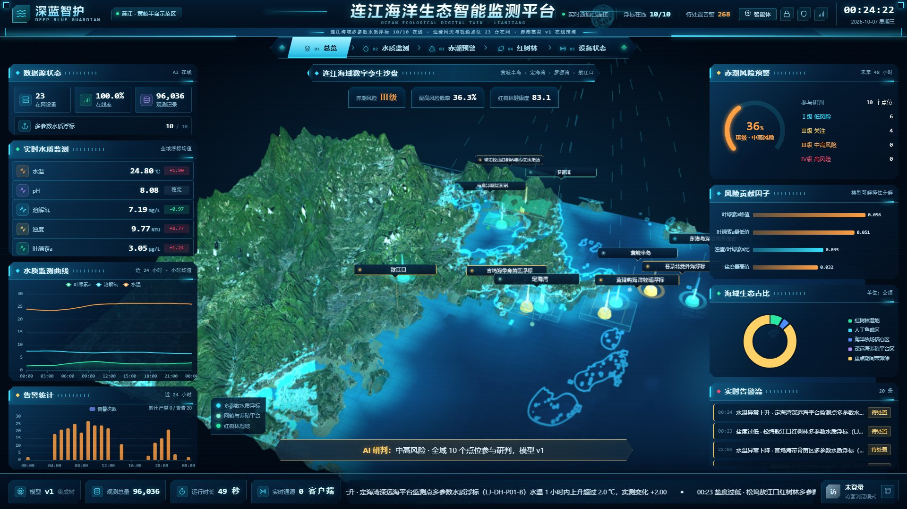

全屏三维海域沙盘为底，左侧聚合实时水质与告警统计，右侧呈现赤潮风险、模型可解释因子、海域生态占比与实时告警流，底部为运行状态栏与滚动告警摘要。

| 水质监测 | 赤潮预警 |
| --- | --- |
| 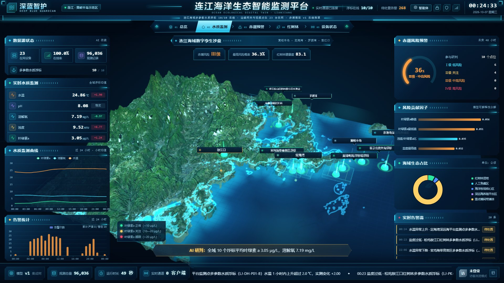 | 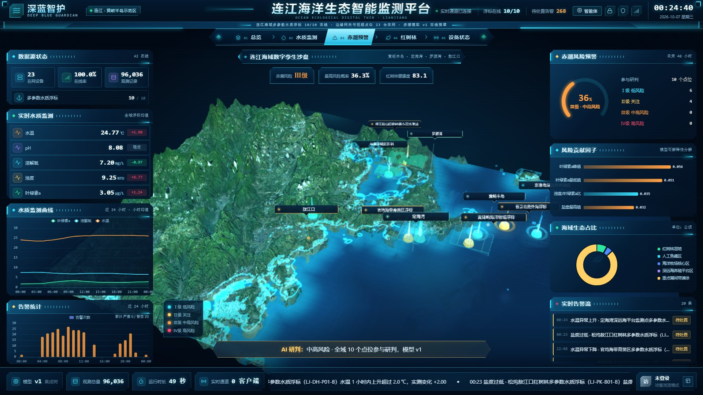 |
| 档位切换后沙盘按指标着色，浮标光柱与 24 h 曲线联动 | 四级风险分级、未来 48 h 概率预测与贡献因子分解 |

| 红树林监测 | 设备状态 |
| --- | --- |
| 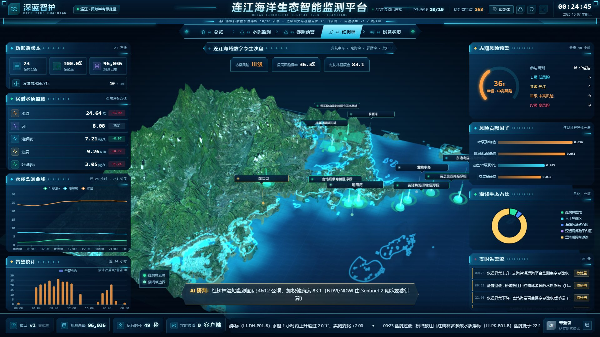 | 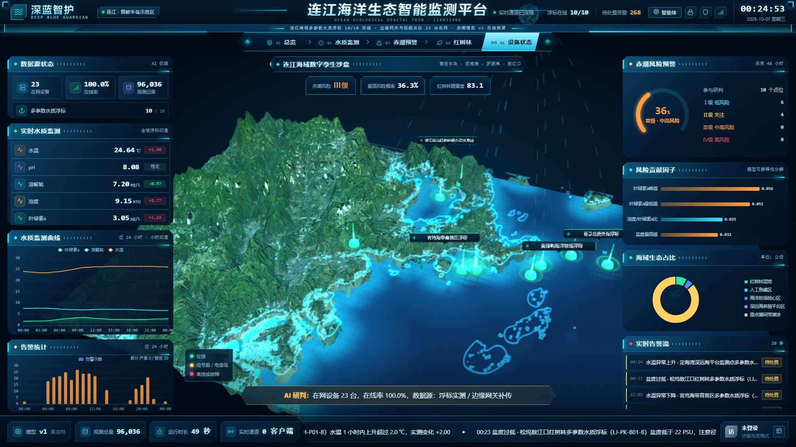 |
| 红树林图斑、健康度与面积变化 | 23 台设备在线率、信号与电量巡检 |

### 海洋生态智能体

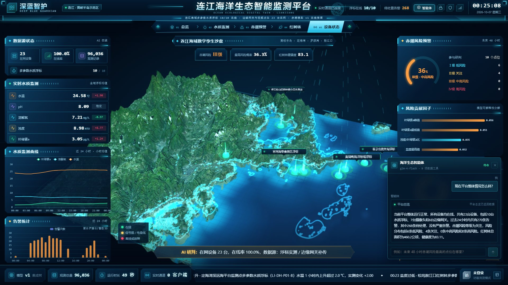

自然语言提问 → GLM function calling 调用 9 项平台数据工具 → 按真实数据成文，并把命中的点位回传大屏高亮。截图中的工具调用轨迹、结论数值与告警条数全部来自数据库。

### 管理后台

| 运行概览 | 设备管理 |
| --- | --- |
| 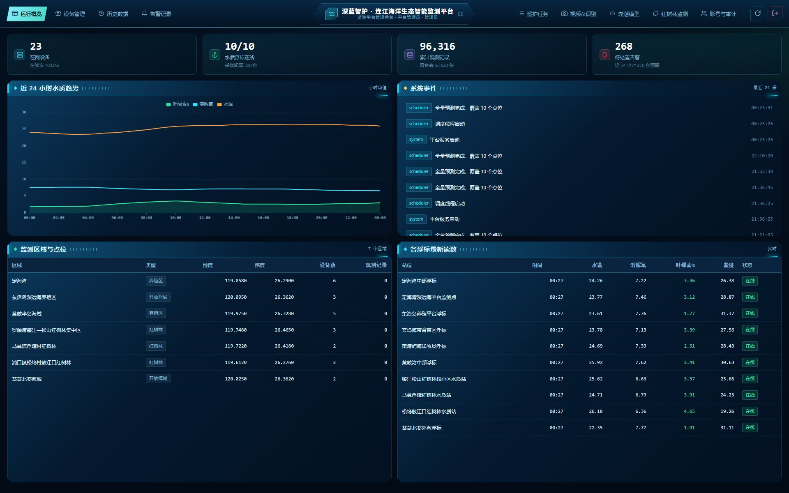 | 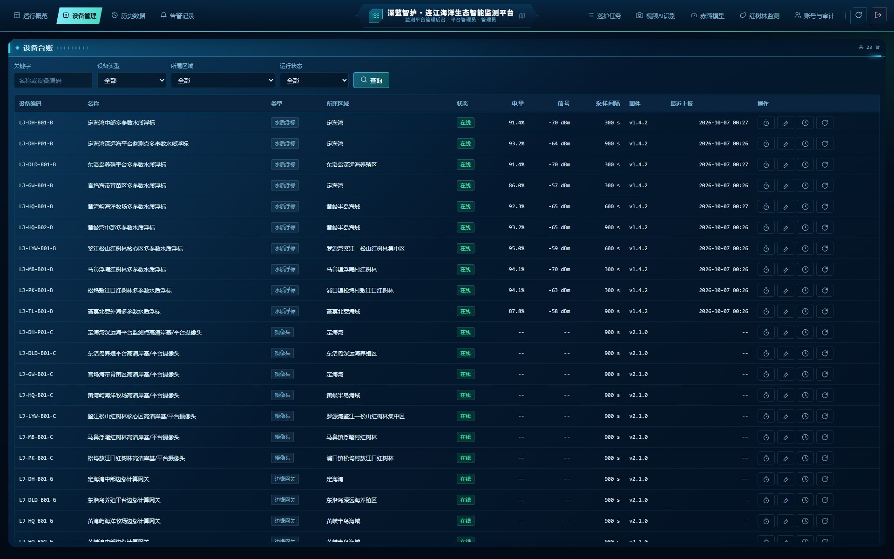 |

| 历史数据 | 告警记录 |
| --- | --- |
| 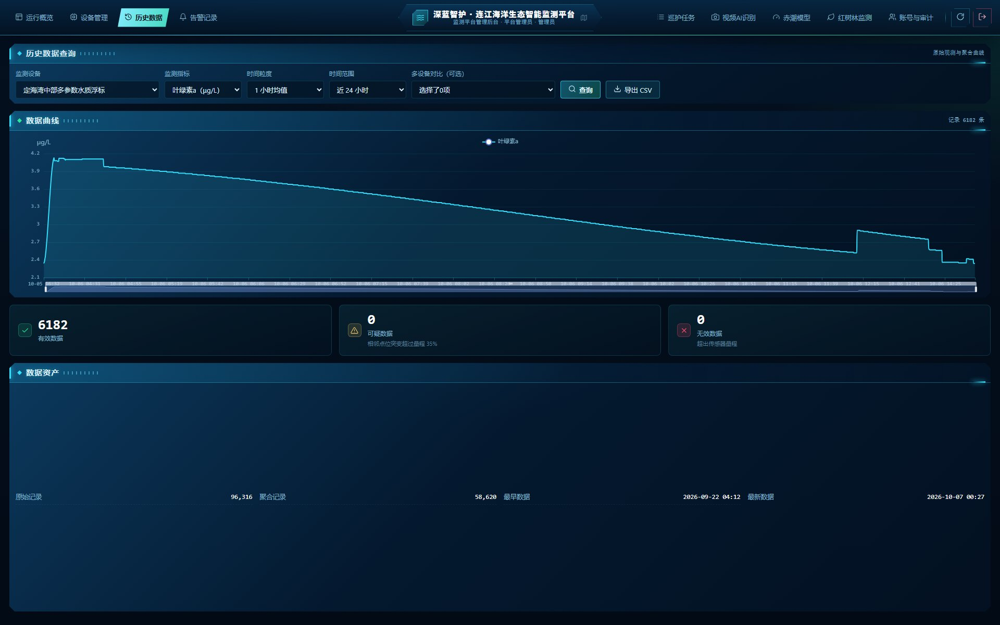 | 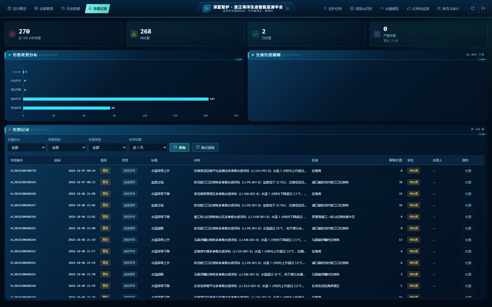 |

| 巡护任务 | 赤潮模型 |
| --- | --- |
| 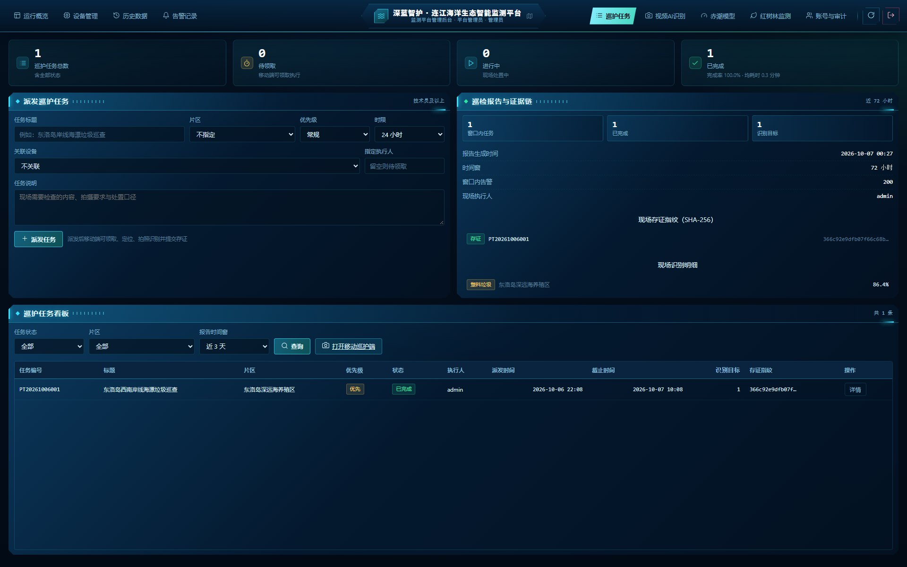 | 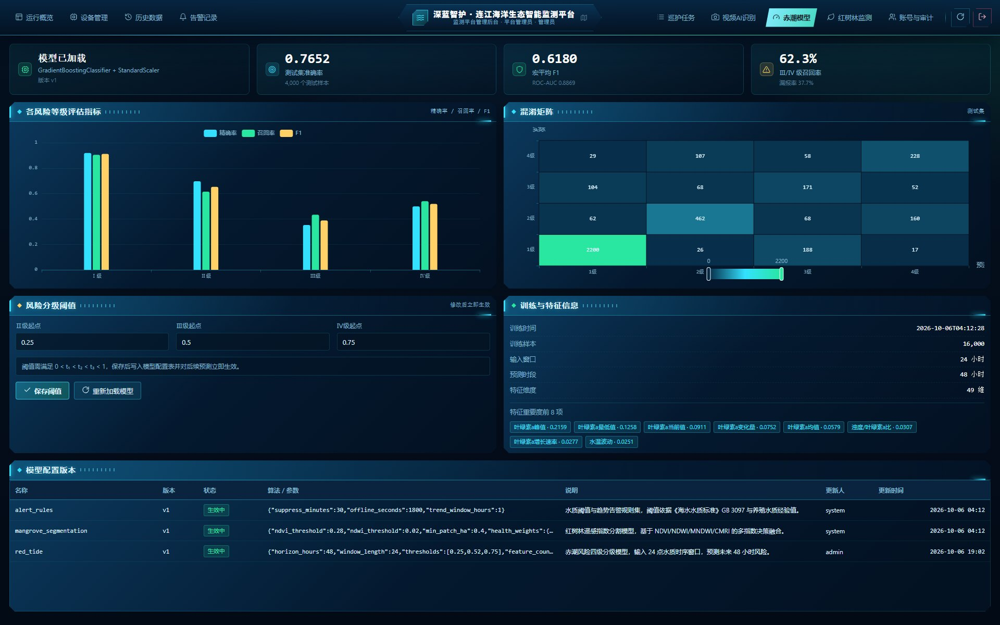 |

| 红树林监测 | 账号与审计 |
| --- | --- |
| 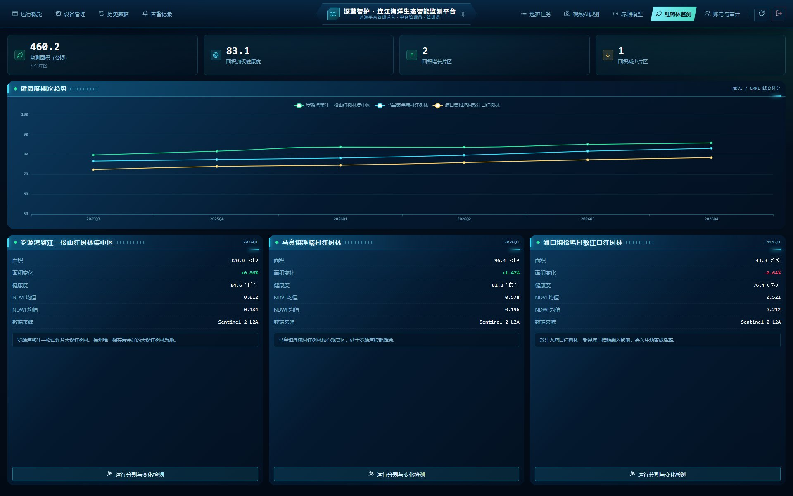 | 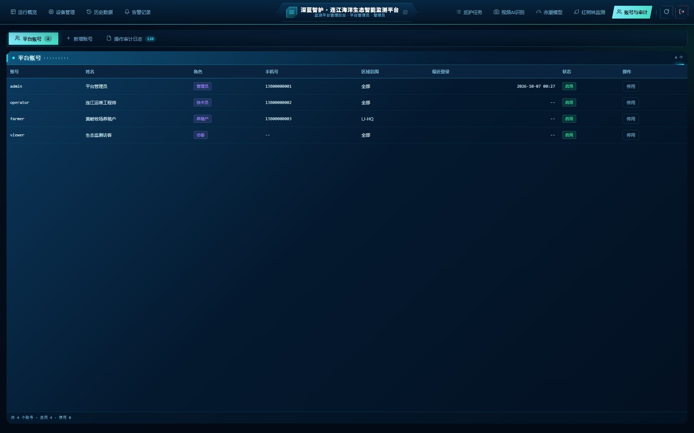 |

### 视频 AI 识别

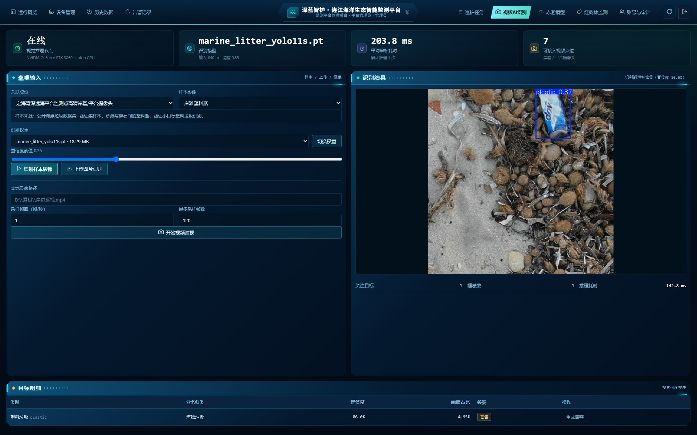

样本为公开海漂垃圾数据集验证集影像（界面同步标注来源与「非实时画面」），图中 `plastic 0.87` 为 YOLO11s 权重单次推理的原始输出，未做平滑或人为抬升；识别结果可一键转为平台告警，进入处置闭环。

### 移动巡护端

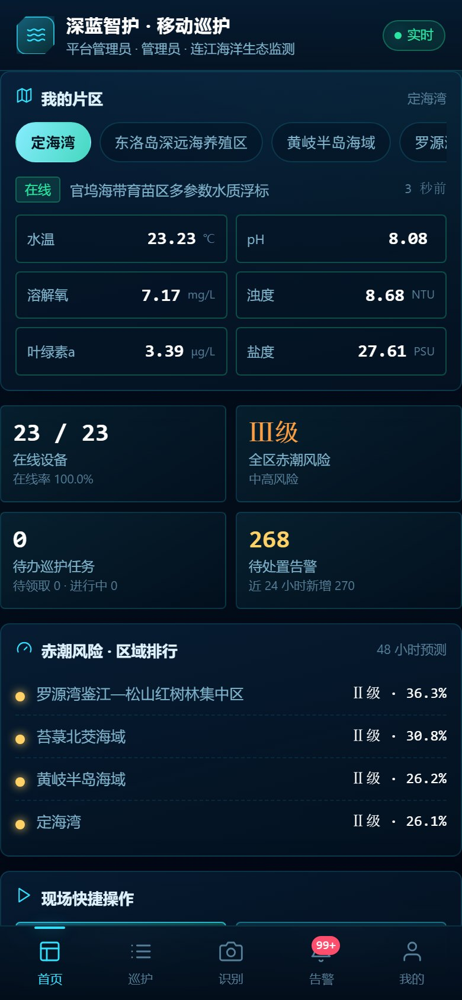

同一套后端接口与设计令牌的移动端视图（`/m`）：片区切换、实时水质指标、赤潮风险区域排行、待办巡护与告警入口。

---
## 目录结构

```
OpcOcean/
├─ backend/
│  ├─ app/
│  │  ├─ main.py               # FastAPI 应用入口（路由挂载、WebSocket、静态资源托管）
│  │  ├─ config.py             # 指标定义、风险等级、告警阈值、趋势规则、运行参数
│  │  ├─ database.py           # SQLAlchemy 引擎与会话（SQLite + WAL）
│  │  ├─ models.py             # 12 张数据表 ORM 定义
│  │  ├─ schemas.py            # Pydantic v2 请求/响应模型
│  │  ├─ security.py           # PBKDF2 口令、HMAC Token、设备接入签名
│  │  ├─ seed.py               # 区域、设备、账号基础数据初始化
│  │  ├─ tasks.py              # 后台调度线程（聚合 / 预测 / 离线巡检 / 卡值检测）
│  │  ├─ routers/              # 11 个业务路由模块
│  │  │  ├─ agent.py           # 海洋生态智能体接口（状态 / 问法 / 问答 / SSE 流式）
│  │  │  └─ vision.py          # 视频 AI 识别接口（点位 / 样本 / 识别 / 巡视 / 转告警 / 权重切换）
│  │  ├─ services/             # 仿真器、告警引擎、聚合、预测、推送
│  │  │  ├─ agent.py           # 智能体工具注册表与多轮工具调用循环
│  │  │  └─ vision.py          # 视觉推理节点托管、结果语义化与告警闭环
│  │  ├─ ml/                   # 赤潮预测与红树林分割算法
│  │  │  └─ artifacts/         # red_tide_v1.joblib / red_tide_v1.json（模型权重与元数据）
│  │  └─ data/sites.py         # 连江 7 区域与真实海域点位（含经纬度与世界坐标映射）
│  ├─ data/models/             # 目标检测权重（marine_litter_yolo11s.pt 等）
│  ├─ data/vision_samples/     # 演示用公开海漂垃圾影像 + samples.json 来源清单
│  ├─ data/deepblue.db         # SQLite 数据库（首次启动自动建表与回填，不入库）
│  ├─ train_red_tide.py        # 赤潮模型训练脚本
│  └─ requirements.txt         # Python 依赖
├─ frontend/
│  ├─ index.html               # 数字孪生大屏（全屏三维 + HUD 浮层）
│  ├─ console.html             # 管理后台
│  ├─ mobile.html              # 移动巡护端（访问路径 /m）
│  ├─ assets/                  # theme.css、screen.js、console.js、core.js
│  │  └─ geo/                  # 卫星影像贴图、SRTM 高程、海岸掩膜（离线烘焙）
│  ├─ vendor/                  # vue.global.prod.js、three.min.js、echarts.min.js
│  └─ favicon.svg
├─ demo/
│  ├─ index.html               # 离线演示包（无需后端，双击即可打开）
│  └─ lib/                     # 离线演示所依赖的 Three.js 与 ECharts
├─ design-system/              # 视觉规范（配色、栅格、组件与图表样式）
├─ docs/                       # 项目文档与界面截图
│  └─ screenshots/             # README「界面实拍」原图（运行中系统真实截图）
├─ vision_service/
│  └─ infer_server.py          # 独立视觉推理节点（标准库 HTTP + Ultralytics YOLO，端口 8001）
├─ tools/
│  ├─ check-ui.js              # 大屏渲染与布局校验
│  ├─ check-flow.js            # 五个视图与七个后台页的流程校验
│  ├─ check-sandbox.js         # 三维沙盘像素非空校验
│  ├─ check-vision.js          # 视频 AI 识别页交互链路与识别结果校验
│  ├─ agent_selftest.py        # 海洋生态智能体自检（工具取数 + 多轮工具调用）
│  ├─ vision_selftest.py       # 视觉推理节点自检（健康检查 / 样本识别 / 告警闭环）
│  └─ build_map_assets.py      # 地理底图资产构建脚本
└─ 深蓝智护-连江海洋生态智能监测平台-项目方案.md   # 完整项目方案文档
```

---

## 快速开始

### 环境要求

- Python 3.10 及以上（已在 3.11/3.12 验证）
- 无需 Node.js 即可运行系统；仅在执行 `tools/*.js` 校验脚本时需要 Node.js
- 视频 AI 识别页额外需要一个含 `torch` 与 `ultralytics` 的 Python 环境运行推理节点，解释器路径由 `DEEPBLUE_VISION_PYTHON` 指定；节点未就绪时平台其余功能不受影响，识别页会如实提示

### 1. 安装依赖

```bash
cd backend
pip install -r requirements.txt
```

### 2. 启动服务

```bash
uvicorn app.main:app --host 0.0.0.0 --port 8000
```

首次启动会自动完成：建表 → 写入连江基础数据 → 回填历史观测 → 重建聚合 → 初始风险预测 → 启动仿真数据源与后台调度线程。

### 3. 访问入口

| 入口 | 地址 | 说明 |
| --- | --- | --- |
| 数字孪生大屏 | http://127.0.0.1:8000/ | 全屏三维海域沙盘 + 左右数据面板 + 底部状态栏 |
| 管理后台 | http://127.0.0.1:8000/console | 运行概览、设备管理、历史数据、告警记录、赤潮模型、红树林监测、账号与审计 |
| 接口文档 | http://127.0.0.1:8000/api/docs | 运行时自动生成的 OpenAPI 文档（ReDoc：`/api/redoc`） |
| 接口索引 | http://127.0.0.1:8000/api | 模块与端点总览 |
| 健康检查 | http://127.0.0.1:8000/api/health | 返回服务、数据库、仿真器与视觉推理节点状态 |

**默认账号**：`admin` / `deepblue@2026`（平台管理员）；另有 `operator` / `ocean@2026`（连江运维工程师·技术员）、`farmer` / `farm@2026`（黄岐牧场养殖户）、`viewer` / `view@2026`（生态监测访客）三个内置账号。

### 4. 离线演示（无后端）

直接双击打开 `demo/index.html` 即可独立演示，内置数据模拟器会滚动水质曲线、演化风险概率并周期性触发告警；`F11` 全屏投屏，鼠标拖拽旋转沙盘、滚轮缩放。

---

## 前端技术栈

| 层面 | 选型 | 说明 |
| --- | --- | --- |
| UI 与状态 | **Vue 3 全局构建**（运行时 + 模板编译，`vue.global.prod.js`） | 视图切换、面板数据绑定、告警列表渲染 |
| 三维引擎 | **Three.js**（`three.min.js`） | 全屏 WebGL 海域沙盘：卫星影像地形、SRTM 高程、海面 Shader、浮标光柱/光环/标签、通信弧线、扫描环 |
| 图表 | **ECharts 5** | 环形图、折线图、柱状图、横向贡献度条形图 |
| 样式 | 原生 CSS（`assets/theme.css`） | 深蓝黑科技底、发光玻璃拟态卡片、左中右三栏、告警弹窗 |
| 构建 | **无构建步骤** | 三方库已本地化到 `frontend/vendor/`，由 FastAPI 直接托管，启动命令只有一条 |

---

## 系统架构

平台按五层结构实现，各层与工程目录一一对应：

| 层 | 职责 | 工程位置 |
| --- | --- | --- |
| 感知层 | 多参数水质浮标、摄像头、太阳能供电 | 硬件方案见项目方案文档第 4 章 |
| 网络传输层 | LoRa 汇聚 + 4G 回传 | 设备上行接入协议（本文档下一节） |
| 边缘计算层 | 边缘网关数据缓存、异常初筛、断网续传 | `POST /api/v1/ingest/*` 接入契约 |
| 云端服务层 | 数据接入、存储、聚合、告警、AI 预测、实时推送 | `backend/app/` |
| 应用展示层 | 数字孪生大屏、管理后台 | `frontend/` |

---

## 硬件接入协议

边缘网关与浮标通过 HTTP 上报数据，接口启动即生效，无需修改前端代码。

### 单条上报

```
POST /api/v1/ingest/reading
```

```json
{
  "device_code": "LJ-DH-B01-B",
  "ts": "2026-10-06T05:30:00",
  "water_temp": 25.4,
  "ph": 8.1,
  "dissolved_oxygen": 7.2,
  "turbidity": 8.5,
  "chlorophyll_a": 3.8,
  "salinity": 28.1,
  "battery": 76.5,
  "signal": -68,
  "source": "buoy"
}
```

服务端返回质量标记（`quality_flag`）与本次触发的告警条数；设备未注册返回 404，上报时间超前 10 分钟以上返回 400。

### 批量上报（支持设备签名）

```
POST /api/v1/ingest/batch
```

- 单批次最多 **2000 条**；
- 携带 `signature` 时按 `HMAC-SHA256(device_secret, "device_code|ts|nonce")` 截取前 32 位校验，允许时钟偏移 ±300 s；
- 质量标记为 2 的记录计入 `invalid`，不参与告警；其余记录逐条评估阈值与趋势规则。

### 链路自检

```
POST /api/v1/ingest/simulate?ticks=1
```

在无硬件到场时触发一次仿真采样，用于验证“采集 → 接入 → 存储 → 告警 → 推送”全链路。

---

## 核心接口

| 模块 | 前缀 | 主要端点 |
| --- | --- | --- |
| 认证 | `/api/v1/auth` | 登录、当前用户、修改口令 |
| 设备管理 | `/api/v1/devices` | 台账、增删改查、统计、区域列表 |
| 数据接入 | `/api/v1/ingest` | `reading`、`batch`、`simulate` |
| 历史数据 | `/api/v1/data` | 原始序列、聚合曲线、多设备对比、CSV 导出、数据量统计 |
| 告警管理 | `/api/v1/alerts` | 列表、筛选、详情、处置回填、类型分布 |
| 赤潮预测 | `/api/v1/predict` | 全点位预测、单点预测、风险汇总 |
| 红树林 | `/api/v1/mangrove` | 分期统计、单区域分割与变化检测 |
| 模型配置 | `/api/v1/models` | 模型信息与指标、阈值与等级映射、模型重载 |
| 大屏总览 | `/api/v1/dashboard` | 首屏快照（总览 + 均值 + 最新读数 + 告警 + 风险 + 红树林 + 生态占比 + 24 h 趋势） |
| 海洋生态智能体 | `/api/v1/agent` | 状态与工具清单、推荐问法、自然语言问答（`chat` 普通 / `chat/stream` SSE 流式） |
| 视频 AI 识别 | `/api/v1/vision` | 推理节点状态与视频点位、样本清单、单图识别、录像巡视、转告警、识别权重切换 |

实时通道：WebSocket `/ws`，推送观测数据（`reading`）、告警与系统事件；客户端可发送 `ping` 保活。

---

## 海洋生态智能体

平台面向赛道 B「大模型 / 智能体」要求落地了**海洋生态智能体**：以智谱 GLM（`glm-4-flash`）为决策中枢，通过 **function calling** 调用平台既有数据接口，把自然语言问题落到真实数据上，并把命中的点位回传大屏做联动高亮。

- **入口**：大屏顶栏「智能体」按钮；`POST /api/v1/agent/chat`（普通）与 `POST /api/v1/agent/chat/stream`（SSE，逐条推送工具调用过程、结论与高亮点位）
- **9 项数据工具**：平台总览、设备清单、水质现状、指标趋势、告警清单、赤潮风险、红树林遥感、处置建议草稿、执行巡检
- **数据口径**：所有数值均由工具从数据库读取（设备台账、观测、聚合、告警、预测、遥感统计），模型只负责编排与表达，不产生数据
- **权限与审计**：只读问答对匿名与全部角色开放；`draft_disposal_plan` 仅产出「待人工确认」草稿，`run_inspection` 需要技术员及以上，二者与每次问答一同写入 `AuditLog`（问题、调用工具、命中点位、模型版本、是否降级）
- **降级容错**：大模型超时、限流或密钥失效时自动切换为本地规则编排，按关键词命中同一批工具并用真实数据成文，返回 `degraded=true`，演示链路不中断且不伪造数值
- **配置**：`ZHIPU_API_KEY` / `ZHIPU_BASE_URL` / `ZHIPU_MODEL` / `DEEPBLUE_AGENT` 环境变量，默认模型 `glm-4-flash`
- **自检**：`python tools/agent_selftest.py`（`--tools-only` 只验证取数，`-q` 跑单个问题）

---

## AI 模型模块

### 赤潮风险等级预测（`ml/red_tide.py`）

- **输入**：某点位过去 24 h 的 6 参数水质时序（滑动窗口 24 步）
- **特征**：展开为 **49 维特征向量**（末值、统计量、变化量、极差、比值与交互项、区间适宜度评分、时间特征）
- **模型**：`StandardScaler` + `GradientBoostingClassifier`，输出四级概率分布
- **分级**：概率按 0.25 / 0.50 / 0.75 映射为 Ⅰ/Ⅱ/Ⅲ/Ⅳ 级，阈值可在后台在线调整
- **可解释**：推理同时输出贡献度最高的 4 项因子（`prediction_log.top_factors`），大屏“风险贡献因子”面板与告警详情直接展示
- **容错**：模型权重缺失或推理异常时自动切换为规则打分路径，保证演示与部署初期不中断
- **当前指标（4000 条仿真测试样本）**：Accuracy 0.7652、宏平均 F1 0.6180、加权 F1 0.7700、ROC-AUC 0.8869、Ⅲ/Ⅳ 级召回率 0.6230

### 红树林遥感分割（`ml/mangrove.py`）

- **方法**：NDVI / NDWI / MNDWI / CMRI 指数阈值组合判定候选像元，叠加“近水约束”与最小图斑形态学过滤
- **输出**：红树林分布掩膜、面积统计、健康度评分、相邻两期增长/退化图斑
- **健康度**：长势（0~70，NDVI 均值）+ 均一度（0~20，NDVI 标准差）+ 连通性（0~10，边缘破碎度），分四级：优（≥80）/ 良（≥65）/ 中（≥50）/ 差
- **演进**：积累足够标注样本后可替换为 U-Net / SegFormer，接口与数据结构保持不变

### 海漂垃圾目标检测（`vision_service/infer_server.py`）

- **权重**：YOLO11s，`backend/data/models/marine_litter_yolo11s.pt`，来自同源项目「连渔智脑 TideSignal」的真实训练成果，非演示占位权重
- **类别（5 类）**：`plastic` 塑料、`foam` 泡沫塑料、`fishing_gear` 废弃渔具、`metal_wood` 金属木质、`debris_other` 其他海漂垃圾
- **训练数据**：公开海漂垃圾影像数据集，训练 6359 张 / 验证 1122 张，60 轮，640×640
- **验证集指标**：Precision 0.9136、Recall 0.8832、mAP50 0.9305、mAP50-95 0.8374
- **节点架构**：独立进程（默认 `http://127.0.0.1:8001`），标准库 HTTP 服务 + Ultralytics，不依赖 FastAPI，与主后端解耦；后端启动时按需拉起，就绪后 `GET /api/health` 的 `vision` 字段返回状态与权重名
- **单帧性能**：RTX 3060 Laptop（CUDA、FP32）实测 115–160 ms/帧，满足逐帧抽样的视频巡视
- **节点接口**：`GET /health`、`GET /classes`、`POST /detect`、`POST /scan`；主后端在 `/api/v1/vision/*` 之上补齐点位、样本、告警与权限
- **关注策略**：只保留平台关心的类别（海漂垃圾 5 类 + 船只 / 浮标 / 网箱 + 少量 COCO 类），过滤球类、风筝等无关检出，避免误报污染告警
- **告警闭环**：识别结果可一键转为平台告警（`type=vision`），进入告警列表并按角色处置回填


### 重新训练赤潮模型

```bash
cd backend
python train_red_tide.py
```

训练脚本使用固定随机种子（`20260501`），产出权重与元数据写入 `app/ml/artifacts/`，服务重启后自动加载。

---

## 数据来源与真实性

平台严格区分真实设备数据与仿真数据，避免把仿真结论表述为实测结果：

| `source` 取值 | 含义 |
| --- | --- |
| `buoy` / `edge` | 真实浮标或边缘网关上行的实测数据 |
| `sim` | 物理机理仿真数据，用于真实设备接入前完成算法与链路验证 |

- 仿真器按连江海域季节水温曲线、潮汐与养殖活动规律构造生态过程模型，输出带 `source=sim` 标记；
- 赤潮模型的训练集为**物理机理仿真数据**（`data_source = physics-simulation`），仅用于验证特征工程与算法链路，不作为实测结论；
- 真实设备接入后，同一套特征工程与训练脚本可直接复用重新训练；
- 各类数据占比可通过 `GET /api/v1/data/volume` 随时核查。
- 海漂垃圾检测权重在**公开海漂垃圾影像数据集**上训练，指标为验证集实测值；内置演示影像同样来自该数据集的验证集样本，`samples.json` 逐张标注来源，界面同步注明「公开数据集样本，非实时画面」；
- 检测精度受光照、水面反光与拍摄距离影响，页面展示的置信度为单次推理原始输出，不做平滑或人为抬升。

---

## 自动化校验

在服务运行（`http://127.0.0.1:8000`）的前提下执行：

```bash
node tools/check-ui.js        # 大屏渲染、布局与文本溢出检查
node tools/check-flow.js      # 五个大屏视图与七个后台页的渲染检查
node tools/check-sandbox.js   # 三维沙盘像素非空检查（WebGL 2.0）
node tools/check-vision.js    # 视频 AI 识别页交互链路与识别结果检查
python tools/vision_selftest.py   # 视觉推理节点健康检查、样本识别与告警闭环
```

脚本基于 Puppeteer，通过环境变量 `BASE_URL` 可切换校验目标地址；校验截图输出到 `tools/` 目录。地理底图资产可通过 `python tools/build_map_assets.py`（可加 `--force`）重新烘焙。

---

## 部署说明

- **运行方式**：单机部署，一条 `uvicorn` 命令即可启动，数据库为免安装的 SQLite 单文件，适合县域低成本推广；
- **前端资源**：由 FastAPI 直接托管 `/`、`/console`、`/assets`、`/vendor`，无需独立 Web 服务器；
- **离线能力**：地理底图与三方库均已本地化，运行时不依赖外网；前端在实时通道断开时自动降级为重连提示；
- **接入真实设备**：将浮标与网关的上报地址改为部署服务器后，`source` 由 `sim` 自动变为设备上行标识，大屏与后台无需改动任何代码。

---

## 许可与数据来源

- 区域属性与点位坐标来自公开权威资料（福州市人民政府、福建省人民政府、福建省林业局、农业农村部国家级海洋牧场公示、福建省海洋预报台）；
- 三维沙盘底图使用 Esri World Imagery 卫星影像与 SRTM 1 弧秒高程数据，来源说明见 `frontend/assets/geo/SOURCE.txt`。
